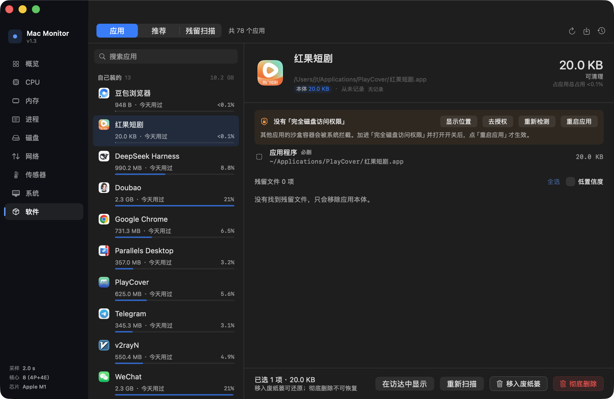
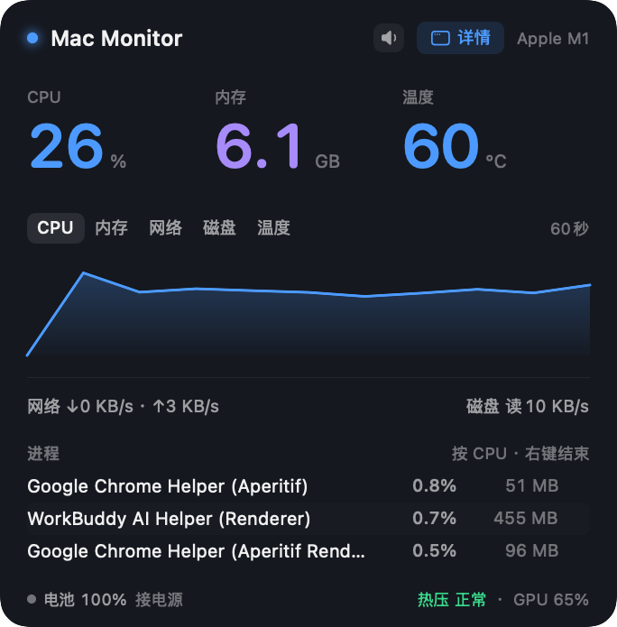

# Mac Monitor（整合版）

菜单栏常驻的 macOS 系统监测工具，**内置软件管理**。原生 SwiftUI + AppKit，
不依赖第三方库，`swiftc` 直接编译，不需要 Xcode 工程。

一边是实时监测：CPU / 内存 / 网络 / 磁盘 / 温度 / 进程；
一边是软件管家：安装 / 卸载 / 残留清理 / 推荐卸载 / 占用分析。
两者共用一个 app、一个菜单栏图标、一份「完全磁盘访问权限」授权。



## 仓库里的三个版本

| 目录 | 形态 | 说明 |
| --- | --- | --- |
| [`macmonitor/`](macmonitor/) | SwiftUI 菜单栏应用 | **整合版 v1.3**，下面讲的就是它 |
| [`macapp-gui/`](macapp-gui/) | SwiftUI 图形应用 | 独立的软件管家 v1.5，只有软件管理，没有监测 |
| [`macapp/`](macapp/) | Python 命令行 | 早期版本，逻辑与 GUI 版一致，适合脚本化和审计 |

`macapp-gui` 和 `macmonitor` 共用同一套卸载引擎——整合版的 `Sources/Manager/`
就是 `macapp-gui/Sources/` 并进去的，只改了三处命名冲突
（`AppInfo` → `ManagedApp`、`Store` → `ManagerStore`、去掉它自己的 `@main`），
逻辑一行没动，自检 338 项两边逐项一致。

---

## 下载

[Releases](https://github.com/jtnetcc/Mac-Monitor/releases) 里有打包好的 dmg，不用 clone：

| 版本 | 下载 | 说明 |
| --- | --- | --- |
| **整合版 v1.3** | [`MacMonitor-1.3.dmg`](https://github.com/jtnetcc/Mac-Monitor/releases/download/macmonitor-v1.3/MacMonitor-1.3.dmg) | 系统监测 + 软件管理，macOS 14+ / arm64，1.9 MB |
| 软件管家 v1.4 | [`MacAppManager-1.4.dmg`](https://github.com/jtnetcc/Mac-Monitor/releases/download/v1.4/MacAppManager-1.4.dmg) | 只有软件管理，没有监测 |

```sh
shasum -a 256 MacMonitor-1.3.dmg
# dbb98d762cee516f357a146fee56159e07275cab38e67bbc9e7d3d2a1d3da638
```

> 两个都是 ad-hoc 签名、没有经过公证，首次打开会被 Gatekeeper 拦一次：
> 右键点图标 →「打开」→ 再点「打开」。
> 软件管理要清沙盒容器，还得给 Mac Monitor 开「完全磁盘访问权限」，
> 详见下面的[软件管理](#软件管理整合自-macapp-gui)。

## 运行

```bash
cd MacMonitor
./build.sh                      # 编译打包 → build/MacMonitor.app
open build/MacMonitor.app       # 启动，图标出现在菜单栏
```

启动后：

| 操作 | 行为 |
|---|---|
| **左键点图标** | 在「精简版 ↔ 详情版」之间来回切换 |
| `⌥M` | 同上（切换） |
| **右键点图标** | 菜单：切换窗口/面板、打开进程管理、打开软件管理、菜单栏显示哪个指标、告警提示音开关、系统工具、退出 |
| `⌥P` | 直接打开详情窗口的「进程」分区 |
| `⌥S` | 直接打开详情窗口的「软件」分区 |
| **右键点进程行** | 结束进程 / 强制结束 / 在 Finder 中显示 / 复制 / 打开活动监视器 |
| **悬停进程行** | 行尾浮出 ✕，单击直接结束 |
| `ESC` 或点面板外部 | 收起精简面板 |

切换循环：什么都没显示 → 精简面板 → 详情窗口 → 精简面板 → …
从精简面板点任意卡片，会直接跳到详情窗口的对应分区。

## 打包成安装包

```bash
./package.sh            # 只出 DMG（默认，拖拽安装）
./package.sh dmg        # 同上
./package.sh pkg        # 只出 PKG（走 Installer.app，一般用不上）
./package.sh all        # 两个都出
```

产物在 `dist/`：

| 文件 | 说明 |
|---|---|
| `MacMonitor-1.3.dmg` | 挂载后是「MacMonitor.app + 应用程序快捷方式 + 安装说明.txt」，拖过去即可 |
| `MacMonitor-1.3.pkg` | 只有显式指定 `pkg`/`all` 才生成，组件包，安装位置 `/Applications` |

打包流程：**生成图标 → 编译签名 → 校验 → 打 DMG（→ 打 PKG）**。

**为什么默认只出 DMG。** PKG 是组件包，安装器会额外做一堆判断——重定位、
同版本跳过、收据残留——每一个都能让「安装成功」变成「其实没装上」。
DMG 就是挂载 → 拖进「应用程序」，中间没有环节可以出错。

DMG 里那个 `.VolumeIcon.icns` 是卷宗图标：不塞的话挂载出来就是个空白硬盘图标。
配合 `SetFile -a C` 打上自定义图标标记才生效。

### PKG 必须关掉「可重定位」（只在用 `./package.sh pkg` 时相关）

`pkgbuild` 在 payload 里发现 `.app` 时，会自动往 `PackageInfo` 写：

```xml
<pkg-info relocatable="true" …>
  <bundle path="./Applications/MacMonitor.app" id="com.local.macmonitor" …/>
  <relocate><bundle id="com.local.macmonitor"/></relocate>
</pkg-info>
```

`<relocate>` 的意思是「安装器你先在磁盘上找找有没有同 identifier 的 app，
找到就装那儿」。而 `build/MacMonitor.app` 正好同 id、就在硬盘上，于是：

- `/Applications` 里什么都没有
- `build/MacMonitor.app` 被 `chown` 成 `root:wheel`（`/var/log/install.log` 里
  能看到 `Touched bundle …/build/MacMonitor.app`）
- 安装器照样弹「安装成功」

修法是打包前把组件清单里的 `BundleIsRelocatable` 改成 `false`：

```bash
pkgbuild --analyze --root "$PKGROOT" "$COMPLIST"
/usr/libexec/PlistBuddy -c "Set :0:BundleIsRelocatable false" "$COMPLIST"
pkgbuild --root "$PKGROOT" --component-plist "$COMPLIST" \
         --install-location / --identifier com.local.macmonitor …
```

改完 `PackageInfo` 里是 `relocatable="false"`，`<relocate/>` 变成空元素（无害），
安装路径强制为 `/`。`package.sh` 打完会 `pkgutil --expand` 回读校验，
只要 `relocatable` 不是 `false`，或者 `<relocate>` 里还有 `<bundle `，就直接报错退出。

另外：装过同版本 PKG 后安装器会认为「已安装」而跳过，
要先 `sudo pkgutil --forget com.local.macmonitor`（或者把版本号往上抬一位）。

**图标是代码画的。** `--iconset <dir>` 让 app 自己渲染 10 个尺寸的 PNG（16~1024），
再用 `iconutil` 合成 `Assets/AppIcon.icns`。好处是每个尺寸都是原生渲染，
16px 不会像缩图那样糊掉，而且图标和菜单栏那个圆环是同一套设计语言。

**签名情况：** `codesign --sign -`（ad-hoc）。没有 Apple 开发者证书，所以：

- 不影响本机运行
- 别人下载后首次打开会被 Gatekeeper 拦一次，需要右键 →「打开」，或者
  `xattr -dr com.apple.quarantine /Applications/MacMonitor.app`
- 想彻底免打扰，得有 Developer ID 证书：`codesign --sign "Developer ID Application: …"` +
  `xcrun notarytool submit` + `stapler`，再把 pkg 用 `productsign` 签一遍

PKG 里会有几个 `._` 开头的 AppleDouble 文件，那是 `com.apple.provenance`
扩展属性（系统加的，`xattr -cr` 也去不掉）的载体，属正常现象，不影响安装。

## 资源占用（MacBook Pro M1 / 8GB / macOS 26.7 实测）

**磁盘** —— 5.1 MB，几乎没有数据文件

| 项目 | 大小 |
|---|---|
| .app 包体 | 5.1 MB |
| 可执行文件 | 4.7 MB |
| 图标 icns（10 个尺寸） | 325 KB |
| 卸载规则 rules.json | 4.6 KB |
| 用户数据 / 缓存 / 数据库 | **≈0**（只有一条 UserDefaults：菜单栏显示哪个指标） |

> 并进软件管理之后包体从 3.0 MB 涨到 5.0 MB，多出来的基本是管家那套
> 扫描 / 判定 / 界面代码。没有引入任何第三方依赖。

**内存** —— 41 MB（仅菜单栏） / 73 MB（窗口打开） / 90 MB（进程页） / 117 MB（软件页）

| 状态 | RSS | 说明 |
|---|---|---|
| 仅菜单栏常驻 | 41 MB | 30 秒采样期内无增长 |
| 打开详情窗口 | 73 MB | 多出约 30 MB 是 SwiftUI 窗口与图表视图 |
| 停在进程页 | 90 MB | 惰性列表只实例化可视行，滚动时按需创建 |
| 停在软件页 | 114 MB | 78 个应用的清单 + 体积 + 画像，扫描完成后会回落 |

> 虚拟内存显示 400+ GB 是 macOS 给所有进程保留的地址空间（共享缓存映射），不是真实占用。

**CPU**

| 状态 | 平均占用 |
|---|---|
| 仅菜单栏 | 2.3% |
| 打开详情窗口 | 4.6% |
| 停在进程页（348 个进程） | 4.9% |
| 停在软件页（选中应用） | 18.5%（含首次扫盘）/ 稳定态 0.3% |

软件页那个 18.5% 是 30 秒窗口的平均值，前 5 秒扫盘就吃掉 3.8 秒 CPU；
扫完之后只剩监测侧 2 秒一次的采样，实测 15→30 秒区间是 0.3%。

开销主要在磁盘 IO 采集（每次遍历 IORegistry 的 `IOBlockStorageDriver`）和进程列表枚举。
进程列表全量 348 条时，非惰性列表会让 CPU 飙到 30%、内存涨到 250 MB（见坑 9），所以必须惰性。

**测量方式**：应用自带 `--stats-run` 模式，用 `task_info(MACH_TASK_BASIC_INFO)` 和 `getrusage` 自报，不依赖外部 `ps`。

```bash
$BIN --stats-run                  # 仅菜单栏，跑 30 秒后打印
$BIN --stats-run --open-window    # 带上详情窗口
```

## 功能

- **CPU** — 总占用、P 核 / E 核分别统计、每核采样趋势
- **内存** — 已用 / 缓存 / 空闲分段条、内存压力等级、Swap 占用
- **电池** — 电量、充放电状态、健康度、循环次数
- **网络** — 实时上下行速率
- **磁盘** — 实时读写速率、剩余空间
- **GPU** — 设备利用率、显存占用
- **温度** — CPU / GPU die 温度、散热压力等级
- **进程** — 全量进程列表，搜索 / 四种排序、右键结束、强制结束、详情面板
- **告警** — CPU 持续高负载 / 内存压力 / 磁盘不足 / 温度过高，带冷却期；**可选提示音**，不看屏幕也听得见
- **趋势图** — 5 个指标 × 4 档时间范围（60秒 / 5分钟 / 1小时 / 24小时）
- **详情页** — 8 个页面，点主面板任意卡片进入
- **菜单栏指标** — CPU / 内存 / 网络 / 温度四选一，圆环与文字跟着换
- **系统工具** — 打开活动监视器、重启 Finder、清空 DNS 缓存、回收内存
- **软件管理** — 安装 / 卸载 / 残留清理 / 推荐卸载 / 占用分析（整合自 macapp-gui）

## 详情窗口

点击主面板任意卡片，或面板右上角的窗口按钮，或右键菜单「打开详情窗口」，会打开一个 **1060×690 的独立深色窗口**。

左侧是分区导航，右侧是内容区：

| 分区 | 内容 |
|---|---|
| **概览** | 4 个 KPI + CPU 大图 + 每核柱状图 + 进程排行 + 网络/传感器速览 |
| **CPU** | 5 个 KPI（总/P/E/负载/温度）+ 大图 + 每核柱状图 + 进程排行 |
| **内存** | 已用/缓存/Wired/Swap/压力 + 占用曲线 + 组成明细 + Swap 条 + 压力说明 |
| **进程** | 5 个 KPI + 搜索框 + 四种排序 + 全量进程表（右键结束 / 单击详情） |
| **磁盘** | 容量/可用/使用率/读/写 + 读写双图 + 文件系统信息 |
| **网络** | 上下行/累计流量/接口 + 下行图 + 上行图 |
| **传感器** | 温度/GPU/显存/热压 + 温度曲线 + 传感器明细 + 温度区间条 |
| **系统** | 芯片/内存/存储/核心/已开机 + 设备信息 + 系统信息 + 存储与电池 |
| **软件** | 软件管家全套：应用清单 / 推荐卸载 / 残留扫描，自带搜索与三段式布局 |

设计要点：

- **深色专业调性** —— 背景 `#0B0D11`，面板 `#15181F`，0.5px 边框，不用阴影
- **每核柱状图** —— 底色是轨道、彩色柱高 = 占用率，E 核青色 / P 核蓝色，比色块热力图更易读
- **坐标轴统一单位** —— 速率轴按量级整体切 KB/s 或 MB/s，不会出现 `2.0 / 1.5 / 523 / 0` 这种混单位刻度
- **窗口可缩放** —— 最小 1000×640，面板用 `maxHeight: .infinity` 弹性填充

## 精简面板



菜单栏下拉的 **342×348** 面板（告警时 393），和详情窗口同一套深色语言，只做速览。

结构（从上到下）：

```
● Mac Monitor                     [详情] Apple M1
─────────────────────────────────────────────
CPU              内存              温度
20 %             6.1 GB            57 °C
─────────────────────────────────────────────
[CPU] 内存 网络 磁盘 温度                60秒
    ╱╲__╱╲___╱╲__  （按峰值铺满的面积图）
─────────────────────────────────────────────
网络 ↓3 KB/s · ↑3 KB/s        磁盘 读 0 KB/s
进程                              按 CPU · 右键结束
Eggplant                  0.8%   300 MB
...
● 电池 100% 接电源         热压 正常 · GPU 66%
```

设计原则：

- **一个视觉重点，不是四个等重的块** —— 三个 34pt 大数字横排，字号差距把「先看哪个」说清楚；
  曲线、IO、进程都退到次要层级。上一版每块一样重，眼睛没有落点
- **曲线按峰值铺满** —— 固定 0–100 的刻度会让 20% 的 CPU 贴着底边、上面空一大片。
  改成峰值 ×1.18 作为上限，曲线始终占满约 85% 高度。代价是曲线变相对刻度，
  绝对数值由上面的巨字给出
- **不用卡片、不堆分隔线** —— 全靠字号对比和留白建立层次，整块面板只有 1 条分隔线
- **不透明深色底** —— 试过毛玻璃（`.hudWindow` + `behindWindow`），浅色壁纸透上来会把白字冲淡，
  完全看不清。改成不透明 `#15181F` + 0.5px 白边，牺牲一点通透感换可读性
- **速率带单位** —— `↓30 KB/s` 而不是裸数字，避免分不清 KB 还是 MB
- **点哪进哪** —— CPU / 内存 / 温度 / 网络 / 磁盘 / 电池都能点，直接跳到详情窗口对应分区
- **进程行可动手** —— 悬停浮出 ✕、右键出菜单，面板里就能收拾掉吃 CPU 的进程，不用切窗口

面板样式做成了可切换的枚举（`PanelStyle`，见 `Sources/PanelStyles.swift`），
一共七版：`current` / `cards` / `rings` / `rows` / `hero` / `dual` / `editorial`。
默认用 `editorial`，其余六版留着对比，`--panel-style <名字>` 可以单独渲染出来看：

```bash
BIN=./build/MacMonitor.app/Contents/MacOS/MacMonitor
$BIN --snapshot /tmp/p.png --panel-style hero --wait 30
```

### 系统信息页

「系统」分区展示机器基本配置：

| 分组 | 字段 |
|---|---|
| 设备 | 型号名称、型号标识、芯片、核心构成（P/E）、统一内存、序列号、架构、系统盘 |
| 系统 | 系统版本、构建号、主机名、局域网 IP、开机时间、已运行、物理/逻辑分辨率、缩放倍率 |
| 存储 | 容量条、已用/可用/共、文件系统、读写速率 |
| 电池 | 电量条、健康度、循环次数、满充/设计容量 |

数据来源分两段加载，避免启动卡顿：

- **同步（毫秒级）**：`sysctl` 取芯片/核心/内存、`IOPlatformExpertDevice` 取序列号、`NSScreen` 取分辨率、`getifaddrs` 取 IP
- **异步（约 0.2 秒）**：`system_profiler SPHardwareDataType -json` 补「型号名称」这类人类可读字段

两个坑：

1. `kern.hostname` 可能被系统设成 IP（这台机器就是 `192.168.1.160`），所以主机名改用 `SCDynamicStoreCopyLocalHostName`，IP 单独占一行
2. `ProcessInfo.hostName` 同样会解析成 IP，不能直接用

## 进程管理

进程表在三个地方出现：精简面板（Top 4）、概览 / CPU / 内存页的排行（Top 10~12）、以及独立的「进程」分区（全量 340+ 条）。
三处共用同一份数据 —— 采集器一次遍历返回全部进程，由 UI 自己 `prefix`，不再为不同页面重复采样。

**三个入口，一个动作**

| 入口 | 适用 |
|---|---|
| 悬停行尾的 ✕ | 最快，误点率低（✕ 平时透明，只在悬停时变红） |
| 右键菜单 | 完整能力：结束 / 强制结束 / 详情 / 定位 / 复制 / 活动监视器 |
| 详情弹层底部按钮 | 看清楚 PID、路径、运行时长之后再动手 |

**结束策略**

| 目标 | 行为 |
|---|---|
| 普通用户进程 | `kill(pid, SIGTERM)`，立即执行，右下角弹提示条 |
| 系统进程（uid < 500） | 先弹确认框，说明这是系统进程 |
| 强制结束 | 先弹确认框，说明未保存的数据会丢 |
| root 拥有的 daemon | `kill` 返回 `EPERM`，改用 `osascript … with administrator privileges` 弹系统授权框 |
| `kernel_task` / `launchd` / `WindowServer` / `loginwindow` / 自己 | 直接拦下，菜单项置灰并说明原因 |

结束成功后立刻把该行从列表里摘掉，不等下一轮采样 —— 否则点了没反应，用户会连点三次。

**进程详情**（单击任意行）

名称、PID、父进程、用户、状态、线程数、CPU、内存、启动时间、运行时长、可执行文件全路径（可选中复制）。
路径长时自动换行，弹层宽度固定 470pt。

**排序与搜索**

CPU / 内存 / 名称 / PID 四种排序，搜索框同时匹配进程名、PID、用户名。

排序里有个细节：按 CPU 排时，一堆 0.0% 的进程会每次刷新都换位置。所以先按 0.05% 分桶、桶内按内存降序。
用「差值容差」而不是「分桶」会踩坑 —— 容差比较不满足传递性（0.70≈0.73、0.73≈0.76，但 0.70≠0.76），
排序结果会出现 0.3% 排在 0.4% 前面的情况（见坑 10）。

## 菜单栏指标切换

右键菜单 →「菜单栏显示」可以选 CPU / 内存 / 网络 / 温度：

| 指标 | 圆环 | 文字 |
|---|---|---|
| CPU | 占用率 | `27%` |
| 内存 | 已用比例 | `74%` |
| 网络 | 按 10 MB/s 折算的活动度 | `↓1.2M` |
| 温度 | 30~100°C 映射到 0~100% | `46°` |

圆环只在数值变化超过 0.5% 时才重绘 —— 四条数据流都会触发刷新，每次新建 `NSImage` 太浪费。
选择存进 `UserDefaults`（`statusMetric`），这是整个应用唯一写盘的东西。

## 告警提示音

告警响不响由一个开关控制，两个入口：

- **面板右上角那个喇叭图标** —— 点一下切换，开了会立刻响一声
- **右键菜单栏图标 →「告警提示音」** —— 带勾选状态

默认**开**，状态存在 `UserDefaults`（`soundAlertEnabled`）。两个入口共用同一个 key，
面板用 `@AppStorage` 读，所以从菜单改完面板会立刻跟上，不会一个显示开一个显示关。

两个级别两个音色，不看屏幕也能分辨轻重：

| 级别 | 音效 | 什么时候 |
|---|---|---|
| 警告 | `Glass`（清亮的铃声） | CPU 持续高负载、内存压力「警告」、磁盘不足、温度 ≥80°C |
| 危险 | `Basso`（低沉的闷响） | 内存压力「严重」、温度 ≥90°C 等 |

几个实现上的选择：

- **只在 `fire()` 里响**。那是新告警的唯一出口，`canFire()` 已经按 `thresholds.cooldown`
  做了冷却，所以不会因为「内存一直高」而每秒响一次
- **声音的冷却期单独放宽到 30 分钟**。面板上的告警条 10 分钟就刷新一次是合理的，
  但同一条告警如果一直成立，声音一天能响四五十次——声音比视觉烦得多，所以按
  `key` 单独记时间，30 分钟内同一条不再响
- **预加载 + 掐断上一条**。`NSSound` 缓存在内存里，不每次现读 aiff；
  上一条还没播完就 `stop()`，连续告警不会叠成一团噪音
- **关掉就真静音**。不会退回系统 beep —— 有些应用「关闭提示音」其实还在 `NSBeep`，
  那个更烦
- 音效文件找不到时（有人清理过 `/System/Library/Sounds`）才退到 `NSSound.beep()`

试听：

```bash
./build/MacMonitor.app/Contents/MacOS/MacMonitor --sound-test
```

## 系统工具

右键菜单 →「系统工具」：打开活动监视器、重启 Finder、清空 DNS 缓存、回收内存。
后两项需要 root，走 `osascript` 授权；结果同样用提示条回报。

## 软件管理（整合自 macapp-gui）

详情窗口左侧「软件」分区，代码在 `Sources/Manager/`，来自
本仓库 [`macapp-gui/`](macapp-gui/) 的引擎。
那块原本是个独立 app（`@main` + `WindowGroup`），并进来只保留了它的 `ContentView`，
入口交给 `Section.software`。

三块功能，顶部用分段控件切换：

| 页面 | 做什么 |
|---|---|
| **应用** | 列出全部已装应用 + 各自散落在系统的文件；勾选后移入废纸篓或彻底删除 |
| **推荐** | 按「多久没用 / 缓存多大 / 本体多大」打分排序，≥50 推荐卸载，≥25 可以考虑 |
| **残留扫描** | 应用已经不在、数据还留着的目录，一次扫出来清掉 |

安全策略原样继承：白名单目录、禁区（`/System`、`~/.ssh`、`~/Library/Keychains`…）、
默认进废纸篓可还原、超过 500 MB 的项单独高亮、彻底删除要二次勾选。
这些不是装饰，是这个项目踩过一次 12 GB 数据被误删的坑之后加的。

### 合并时改了什么

只有三处，逻辑一行没动：

| 改动 | 原因 |
|---|---|
| `AppInfo` → `ManagedApp` | 和监测侧的 `AppInfo`（应用版本号）重名 |
| `Store` → `ManagerStore` | 避免和 `MetricsStore` 混淆，也便于区分两个数据源 |
| 删掉 `main.swift` | 里面是管家自己的 `@main` 和 `AppDelegate`，一个 module 只能有一个入口 |

另外文件名加了 `Manager` 前缀（`ManagerStore.swift`、`ManagerViews.swift`…），
因为 `swiftc` 不接受同名源文件，而两边都有 `Store.swift` / `Views.swift`。

### 状态放在窗口层，不放在视图里

```swift
// MonitorWindowView
@StateObject private var manager = ManagerStore()
```

如果按直觉把 `@StateObject` 写在 `SoftwareView` 里，每次从「软件」切到「CPU」再切回来，
`ManagerStore` 就被销毁重建，`ContentView.onAppear` 里的 `refresh()` 会重新全盘扫一遍
（Spotlight 索引 + 逐个算体积，实测 7 秒）。挂在窗口这一层，一个窗口只扫一次。

### 扫描有多快

点开一个应用要扫的东西不止本体：`~/Library` 下可能有几个 GB 的容器。冷缓存时
遍历 686 MB 的微信容器，`du` 实测要 5.2 秒——这不是算法慢，是磁盘要给。

所以做了四件事：

| 改动 | 效果 |
|---|---|
| 先收集候选路径，去重之后再算体积 | 同一个目录不再被整棵遍历两遍（微信 383+185 ms → 一次） |
| 体积用 `fts(3)` 而不是 `URLResourceValues` | 热缓存 383 ms → 176 ms，和 `du` 打平 |
| 清单先出、体积后填 | 用户看到列表的时间：几百毫秒 → 30~90 ms |
| 体积按路径缓存 5 分钟 | 切走再切回来 8~9 ms |

`--scan-timing <应用名>` 可以把这三段分别打出来：

```
完整 scan()：
      30 ms  清单就绪（用户看到列表）
     213 ms  冷缓存跑完（含算体积）
       8 ms  热缓存再跑一遍
```

应用列表本身也从 7.0 秒降到 2.0 秒（同样是 `fts` 的功劳），
而且现在先甩空列表再逐个填体积，不用对着空窗口等。

### 需要「完全磁盘访问权限」

卸载时要清 `~/Library/Containers` 这类沙盒数据，受 TCC 保护，普通应用删不掉——
**`sudo` 也不行**，TCC 是按发起进程判定的。

- 授权：系统设置 → 隐私与安全性 → 完全磁盘访问权限 → 加入 Mac Monitor → 重启应用
- 不授权也能用：应用会自动改请访达代删，只是每次多弹一次确认，且要清空废纸篓才算真删掉
- ad-hoc 签名每次重编都会变，旧授权记录可能失效，必要时从列表里删掉再加一次

## 数据源（全部原生 API，不轮询 shell）

| 指标 | API |
|---|---|
| CPU 分核 | `host_processor_info` + `PROCESSOR_CPU_LOAD_INFO` |
| CPU 负载均值 | `getloadavg` |
| 内存 | `host_statistics64` (`vm_statistics64_data_t`) |
| 内存压力 | `sysctl kern.memorystatus_vm_pressure_level` |
| Swap | `sysctl vm.swapusage` |
| 网络 | `getifaddrs` → `if_data.ifi_ibytes/ifi_obytes` |
| 磁盘容量 | `statfs` |
| 磁盘 IO | IORegistry `IOBlockStorageDriver` → `Statistics` |
| 电池 | `IOPSCopyPowerSourcesInfo` + IORegistry `AppleSmartBattery` |
| GPU | IORegistry `IOAccelerator` → `PerformanceStatistics` |
| 温度 | `IOHIDEventSystemClient`（dlsym 私有符号）+ `ProcessInfo.thermalState` |
| 进程 | `proc_listallpids` + `proc_pidinfo` + `proc_pidpath` |

## 踩过的坑（都是实测出来的）

### 1. Apple Silicon 的 P 核 / E 核编号顺序

`hw.perflevel0.logicalcpu` 只告诉你 P 核有几个，不告诉你哪几个。起 4 个 `yes` 满载观察：

```
core 0: 72.9%   core 4: 99.3%
core 1: 74.8%   core 5: 99.3%
core 2: 82.9%   core 6: 99.3%
core 3: 94.3%   core 7: 99.3%
```

结论：**E 核编号在前，P 核在后**。P 核 = 最后 `perflevel0.logicalcpu` 个索引。

### 2. 电池健康度不能自己算

`AppleRawMaxCapacity / DesignCapacity` = 4078/5103 = **80%**，系统设置显示 **88%**。Apple 做了平滑校准。
解决：启动时调一次 `system_profiler SPPowerDataType -json`（0.2s），直接读系统值。

### 3. 温度：AppleSMC 在 Apple Silicon 上完全不可用

试了 SMC 的 `F0Ac` / `TC0P` / `TC0D`，`IOConnectCallStructMethod` 全部返回 `size=0`。
必须走 `IOHIDEventSystemClient`，匹配 `PrimaryUsagePage 0xff00 / PrimaryUsage 5`，能拿到 57 个传感器。
CPU 温度 = 所有 `PMU tdie*` 的平均值。

### 4. HID 客户端的两个致命细节

**必须长期持有 client。** 写成局部变量会在函数返回时被释放，services 句柄随即失效——表现为读到 0，严重时直接在 `CFRelease` 里 `EXC_BREAKPOINT` 崩溃。

```swift
// ❌ 局部变量，函数返回即释放
guard let client = create(kCFAllocatorDefault)?.takeRetainedValue() else { return }

// ✅ 存成属性
guard let c = create(kCFAllocatorDefault)?.takeRetainedValue() else { return }
self.client = c
```

**必须在主线程访问。** 放到后台队列初始化会被系统 SIGKILL（退出码 137）。温度采样只有十几个传感器，主线程开销可忽略。

### 5. `proc_name()` 会被内核截断

返回最多 32 字符，进程名全是 `Google Chrome Helper (Aperitif` 这种残废状态。
改用 `proc_pidpath()` 取可执行文件全名。

### 6. 风扇转速读不到（试了四条路）

M1 MacBook Pro 13" 有风扇，但 macOS 26 上读不到。四条路都试过：

| 方法 | 结果 |
|---|---|
| SMC 键 `F0Ac` / `F0Mn` / `F0Mx`（`AppleSMC` 服务） | `result=132`（0x84 = 键不存在） |
| SMC 键 `#KEY`（键总数，本该永远存在） | 同样 `result=132` |
| `AppleSMCKeysEndpoint` 服务 + open type 0/1 | 同样 `result=132` |
| IOHID 全量扫描（usage page 0xff00，58 个传感器） | 全是温度，无风扇项 |
| IORegistry 搜 `fan` / `F0Ac` | 无节点（搜到的 `F0` 是 DRAM 通道名） |

连 `#KEY` 都返回"键不存在"，说明**不是某个键的问题，是整个 SMC 键接口在这台机器上不开放**。
要用风扇数据，得走特权 helper（`SMJobBless`）或 root 权限，对一个菜单栏小工具来说不值得。

界面上的处理：不显示假数字，标注「系统未开放」，并在散热面板里说明原因。

### 7. 菜单栏图标在彩色壁纸下隐形

第一版把圆环画成 `isTemplate = false` 并写死 `NSColor.systemBlue`，结果蓝色壁纸 + 蓝色图标 = 看不见。

**菜单栏图标必须用 template 图像**——它只用 alpha 通道，由系统按菜单栏实际配色着色（浅色栏→黑、深色栏→白、彩色壁纸→白）。文字同理，用 `button.title` 而不是 `attributedTitle`，颜色交给系统。

```swift
// ❌ 写死颜色，遇到同色壁纸就消失
img.isTemplate = false
NSColor.systemBlue.setStroke()

// ✅ template + 只用 alpha，系统负责着色
NSColor.black.setStroke()          // 系统会重新染色
img.isTemplate = true
```

只有告警状态（≥80%）才切成橙/红固定色——饱和色在绝大多数壁纸下都够醒目。

验证：`$BIN --icon-preview out.png` 会渲染浅色 / 深色 / 蓝色壁纸三种背景 × 正常 / 警告 / 危险三态的可读性对比图。

### 8. 非特权进程读不到 root daemon 的 taskinfo

`proc_listallpids` 能列出全部 610 个进程，但对着 `launchd`（pid 1）调 `proc_pidinfo(PROC_PIDTASKINFO)` 返回 0、`errno = EPERM`，
连 `PROC_PIDTBSDINFO` 和 `proc_pidpath` 也一样。于是列表里只剩 380 个属于当前用户的进程，系统 daemon 全部消失。

这不是 bug 而是权限：Activity Monitor 能显示它们，是因为它有 Apple 私有 entitlement。第三方 app 只有两条路 ——
装一个 root helper（`SMJobBless`），或者接受看不到。

最后选了第三条：**能读多少列多少**。读不到指标的进程标记 `hasMetrics = false`，表格里显示 `—`，
但依然可以结束（会走提权）。同时试过 `sysctl KERN_PROC_ALL`，它能拿到全部进程的名字和 uid，
可惜 macOS 的 `vmspace` 结构对用户态是空壳，没有 `vm_rssize`，拿不到内存，所以没有采用。

### 9. 344 行非惰性列表 = 30% CPU / 250 MB

进程页第一版用了 `ScrollView { VStack { ForEach(全部进程) } }`。功能正常，但实测：

| 列表容器 | CPU | RSS |
|---|---|---|
| 非惰性 `VStack` | **30.4%** | **250 MB** |
| `LazyVStack` | 4.9% | 90 MB |

每次指标刷新（每 2 秒 5 条数据流）都会重排整张表，340 行 × 7 个文本视图 ≈ 2400 个视图实例。
换成 `LazyVStack` 后只实例化可视区的那 20 来行。

副作用：`ImageRenderer` 渲染不出 `ScrollView` 里的内容，`--window` 导出的进程页会是空白。
所以窗口视图有个 `snapshotMode` 开关，截图时改用扁平列表 + 只取前 16 行。

### 10. 排序比较函数必须满足传递性

想让「CPU 相同的行按内存排、不要每次刷新乱跳」，第一版写成：

```swift
if abs(a.cpu - b.cpu) > 0.05 { return a.cpu > b.cpu }   // ❌ 不满足传递性
return a.mem > b.mem
```

结果表格里出现 0.3% 排在 0.4% 前面。因为 `0.70 ≈ 0.73`、`0.73 ≈ 0.76` 但 `0.70 ≠ 0.76`，
这种「近似相等」不是等价关系，`sort` 拿到不合法的比较函数就会给出任意顺序。

改成量化分桶（0.05% 一档）就满足传递性了：

```swift
let ba = Int(a.cpu * 20), bb = Int(b.cpu * 20)          // ✅ 桶是整数，天然可传递
if ba != bb { return ba > bb }
return a.mem > b.mem
```

### 11. `$VAR` 后面紧跟中文全角标点，变量会展开成空

`package.sh` 里写：

```bash
echo "…（916K，$LOC，$FILES，不可重定位）"      # ❌ 输出成「916K，，，不可重定位」
```

UTF-8 locale 下 bash 判断「变量名字符」的规则会把 `，`（`EF BC 8C`）的字节也算进标识符，
于是它去找一个叫 `LOC，` 的变量 —— 当然不存在，展开成空字符串。加花括号就好：

```bash
echo "…（916K，${LOC}，${FILES}，不可重定位）"   # ✅
```

排查时 `bash -x` 的输出里能看到被吃掉一半的 UTF-8 序列（`\xbc\x8c\xbc\x8c`，`0xEF` 没了）。

### 12. 两个独立 app 并成一个 module 会撞什么

把软件管家并进来时，`swiftc Sources/*.swift Sources/Manager/*.swift` 直接报的错只有一个：

```
error: filename "Store.swift" used twice: 'Sources/Store.swift' and 'Sources/Manager/Store.swift'
```

**Swift 一个 module 里不允许两个同名源文件**，哪怕它们的内容完全不相干。
所以管家那批文件全部加了 `Manager` 前缀。

类型层面只撞了两个名字：`AppInfo`（这边是应用版本号，那边是应用信息）和 `AppDelegate`。
`Store` 其实不撞（这边早改叫 `MetricsStore` 了），但为了不让人在两个数据源之间犯迷糊，
顺手一起改了名。

入口是另一个坑：管家是 `@main struct MacAppMain: App`，这边是 `main.swift` 顶层代码。
一个 module 只能有一个入口，所以管家的 `main.swift` 整个删掉，只留它的 `ContentView`。
它原来的 `--selftest` / `--recommend` / `--orphans` 三个命令行入口搬到了这边的
`main.swift` 里，参数名保持不变。

还有一条不那么显眼但很贵的：**状态对象要挂在窗口层**。
管家原本是独立 app，`@StateObject var store = Store()` 写在 `App` 上，活到进程结束；
并进来之后如果照着写在 `SoftwareView` 里，切走分区就销毁、切回来就重新全盘扫一遍（7 秒）。
所以它挂在 `MonitorWindowView` 上——窗口在，状态就在。

### 13. 无限动画的 `ProgressView` 会把主线程钉死在布局里

现象：点开某个应用，界面停在「正在扫描 … 的残留文件…」一直转圈，点不动，
Activity Monitor 里 CPU 100%，但扫描其实早就结束了。

`sample` 抓下来是 2225 个采样全部在 `SwiftUICore` 的布局栈里：

```
NSApplication run → nextEventMatchingMask → CFRunLoop → flushObservers
  → LayoutEngineBox.sizeThatFits → StackLayout.placeChildren → …（循环）
```

原因是 `ProgressView()` 的无限旋转动画：它每一帧都让窗口失效，
而当时左侧列表有 78 行，**单次重排就超过一帧的时间**。于是主线程永远在处理
「失效 → 重排 → 再失效」，`DispatchQueue.main.async` 里的完成回调一次都排不进来——
`plan` 永远是 nil，界面永远显示「扫描中」，反过来又让动画继续转。死锁。

两个改法：

- 所有 `ProgressView()` 换成静态图标（`BusyDot`）。进度靠文字表达
  （「正在统计体积 20/78…」），不需要动的东西别动。
- `SoftwareView` 加 `Equatable` + `.equatable()`：监测侧每 2 秒刷新一次指标，
  `MonitorWindowView` 会整棵重新求值，不做这个比较的话软件页那 78 行每 2 秒重排一遍。

顺带把扫描改成「清单先出、体积后填」——转圈状态从几百毫秒压到几十毫秒，
就算哪里再出问题也不会长时间停在那个状态。

### 14. 体积口径要和 `du` 对齐

原来用 `FileManager.enumerator` + `URLResourceValues(.totalFileAllocatedSize)`，
换成 `fts(3)` 之后发现同一批目录的数字变小了（豆包本体 1.8 GB → 1.2 GB，
总占用 12.7 GB → 10.9 GB）。用 `du -sk` 一核对，**新的数字才是对的**：
`totalFileAllocatedSize` 对 APFS 透明压缩的文件报的是逻辑大小，
`st_blocks * 512` 才是真实占用的磁盘块。用户拿 Finder / `du` 一比就露馅，
所以这个「变小」是修正，不是退化。

## 代码结构

```
MacMonitor/
├── build.sh                     # 编译 + 组装 bundle + ad-hoc 签名
├── package.sh                   # 生成图标 → 打 DMG / PKG
├── Info.plist                   # LSUIElement=YES（不占 Dock）
├── Assets/AppIcon.icns          # 打包时由 app 自己画出来（不入库）
├── Resources/rules.json         # 软件管理的卸载规则表（进 bundle 供 Scanner 读）
└── Sources/
    ├── Models.swift             # 数据模型、格式化、多分辨率历史缓冲
    ├── Collectors.swift         # CPU/内存/网络/磁盘/电池/进程 采集器
    ├── Sensors.swift            # 温度（HID）与 GPU（IOAccelerator）
    ├── ProcessActions.swift     # 结束进程（含提权）、详情、定位、系统工具
    ├── Store.swift              # 聚合 + 定时驱动 + 告警引擎 + 进程操作入口
    ├── Views.swift              # 精简面板 + 提示条
    ├── WindowViews.swift        # 详情窗口 8 个分区 + 进程表 / 详情弹层
    ├── SoftwareView.swift       # 「软件」分区的接线（把管家 ContentView 塞进窗口）
    ├── main.swift               # 菜单栏 + 面板 + 快捷键 + 图标渲染 + 调试模式
    └── Manager/                 # 软件管理（整合自 macapp-gui）
        ├── ManagerModel.swift        # ManagedApp / 残留项 / 推荐引擎
        ├── ManagerScanner.swift      # 应用发现 + 文件归属匹配（含 rules.json）
        ├── ManagerOrphanScanner.swift# 残留扫描
        ├── ManagerSafety.swift       # 路径白名单 / 禁区 / TCC 探测
        ├── ManagerTrasher.swift      # 移入废纸篓 / 彻底删除
        ├── ManagerInstaller.swift    # dmg/zip/pkg 安装
        ├── ManagerFinderBridge.swift # 让访达代删（TCC 兜底）
        ├── ManagerStore.swift        # 软件管理状态机
        ├── ManagerViews.swift        # 管家全部界面
        └── ManagerSelfTest.swift     # 338 项自检
```

## 调试参数

```bash
BIN=./build/MacMonitor.app/Contents/MacOS/MacMonitor

$BIN --snapshot out.png                  # 用真实数据渲染界面 PNG（跑 16 秒积累曲线）
$BIN --snapshot out.png --tab-temp       # 强制显示温度标签页
$BIN --snapshot out.png --demo-alert     # 注入一条告警，验证告警条布局
$BIN --window out.png overview           # 导出详情窗口（overview/cpu/memory/process/disk/network/sensor/system/software）
$BIN --icon-preview out.png              # 渲染菜单栏图标在不同背景下的可读性对比
$BIN --app-icon out.png 1024             # 渲染应用图标（单张 PNG，默认 1024）
$BIN --iconset Assets/AppIcon.iconset    # 渲染整套 iconset，供 iconutil 合成 icns
$BIN --sound-test                        # 试听告警提示音（Glass / Basso），并检查音效文件是否存在
$BIN --probe                             # 自检：菜单栏位置、面板状态、当前指标、Top 5 进程

$BIN --probe --probe-alert               # 自检 + 验证告警时面板高度自适应
open build/MacMonitor.app --args --open-panel   # 启动时自动展开面板

# 打开窗口并直接停在某个分区（配合 --stats-run / --probe 调试用）
$BIN --stats-run --open-window --section process
$BIN --stats-run --open-window --section software

# 软件管理带过来的调试入口
$BIN --selftest                          # 338 项自检（路径安全 / 残留判定 / 推荐引擎…）
$BIN --recommend                         # 打印每个应用的画像与推荐分数
$BIN --orphans                           # 只看高置信度残留
$BIN --orphans all                       # 连中置信度一起看
$BIN --scan-timing 微信                   # 拆开看扫描各阶段耗时（清单 / 冷缓存 / 热缓存）
$BIN --section software --select 微信     # 开窗并自动选中某个应用，复现扫描流程
```

## 还没做的

- 风扇转速（见坑 6，需要另外的私有路径）
- 系统通知（`UNUserNotificationCenter` 对 ad-hoc 签名应用有崩溃风险，目前用面板内告警条 + 菜单栏变色代替）
- 历史数据持久化（曲线只存内存，重启即清空；24 小时档要跑满一天才有完整数据）
- 系统 daemon 的 CPU / 内存（见坑 8，需要 root helper）
- 进程树视图、按用户分组、批量结束

## 相关文档

- [macapp-gui/README.md](macapp-gui/README.md) —— 独立版软件管家（TCC 权限、构建细节、调试入口）
- [macapp/README.md](macapp/README.md) —— Python 命令行版
- [mac-app-manager-plan.md](mac-app-manager-plan.md) —— 最初的设计方案与取舍
- [CHANGELOG.md](CHANGELOG.md) —— 更新日志
